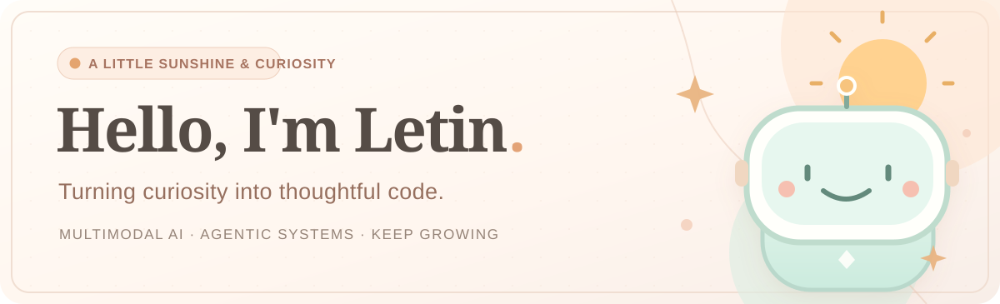

  

  # 🌷 Letin's Little Corner

  **一个有代码、有好奇心，也有一点阳光的个人网站。**

  [☀️ 访问在线主页](https://letin147.github.io/) · [👩‍💻 我的 GitHub](https://github.com/Letin147) · [✉️ 联系我](mailto:lehhe@mails.guet.edu.cn)

---

## 🍑 关于这个网站

这里是 **Letin 的个人主页源代码仓库**，用于展示我作为计算机专业学生的学习、研究兴趣和生活日常。

设计希望传达一种简单的感觉：**轻盈、温暖、真诚，同时保留对技术的热爱。**

- **视觉气质：** 奶油白底色、暖杏橘点缀、柔和薄荷绿、留白与圆角。
- **技术方向：** 多模态大模型、视觉语言对齐、智能体系统、RAG 与高效微调。
- **网站内容：** 关于我 / 研究兴趣 / 学习清单 / 小小实验室 / 生活 / 联系方式。
- **实现方式：** HTML + CSS + JavaScript 的静态网站，无需复杂框架或后端。

## 🧩 项目结构

	repository-root/
	├── index.html             # 网站结构与内容
	├── styles.css             # 布局、配色和响应式样式
	├── script.js              # 导航与小交互
	├── assets/                # 插画、图标与 README 横幅
	│   └── readme-banner.svg
	└── README.md              # 你正在阅读的说明

> 提示：这个仓库的 README 是**网站介绍**；真正出现在 GitHub 个人账号首页的 README 位于独立仓库 [Letin147/Letin147](https://github.com/Letin147/Letin147)。

## 🚀 GitHub Pages 部署

本网站通过 GitHub Pages 托管：

1. 在仓库 **Settings → Pages** 中将 Source 设置为 **Deploy from a branch**。
2. 选择 **main** 分支和 **/(root)** 目录。
3. 提交网站代码后，等待 GitHub Pages 的构建部署流程完成。
4. 访问 **https://letin147.github.io/** 查看效果。

## ✉️ 交流与合作

欢迎交流多模态 AI、Agent 架构、开源实践以及各种有趣的想法：

**[lehhe@mails.guet.edu.cn](mailto:lehhe@mails.guet.edu.cn)**

  ☀️ Keep learning, keep building, and enjoy the little things.

